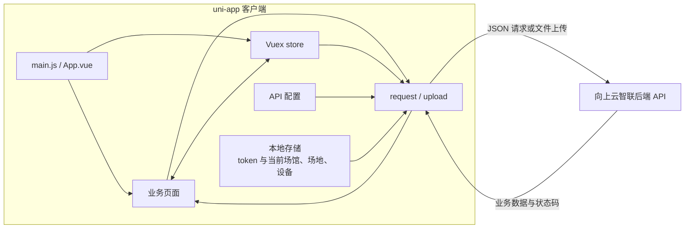
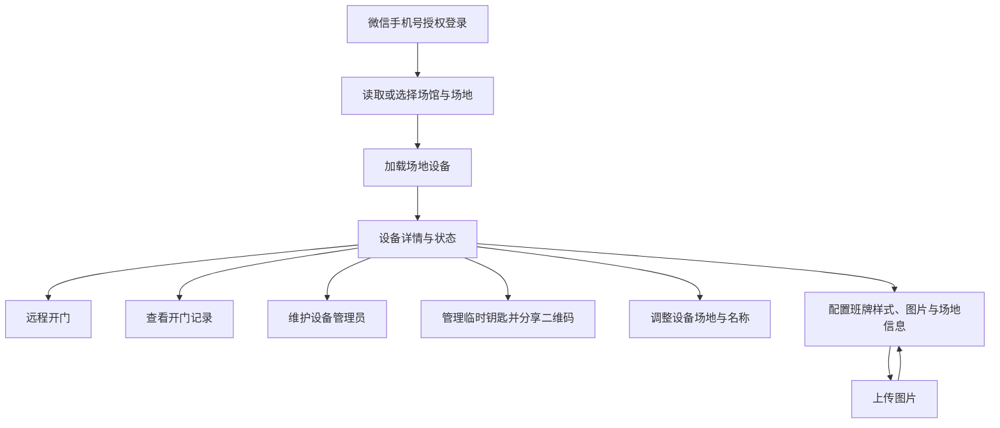

# 向上云智联前端

面向单位管理人员的 uni-app 小程序前端，用于按场馆和场地查看 IoT 设备，并进行设备控制、管理员维护、临时钥匙管理和设备信息配置。本文档从项目入口、业务页面和前端实际调用的接口说明代码的工作方式。

## 目录

- [项目概览](#项目概览)
- [运行原理](#运行原理)
- [模块与页面](#模块与页面)
- [运行与配置](#运行与配置)
- [请求约定](#请求约定)
- [接口清单](#接口清单)
- [当前实现边界](#当前实现边界)

## 项目概览

| 项目 | 说明 |
| --- | --- |
| 应用 | 向上云智联单位设备管理端 |
| 客户端框架 | uni-app，Vue 2 |
| 状态管理 | Vuex |
| 当前小程序配置 | 微信小程序，配置位于 `manifest.json` |
| 页面注册 | `pages.json` |
| API 地址 | `static/config/index.js` |
| 网络封装 | `common/request/index.js` |

该仓库是客户端工程，不包含后端服务源码，也没有根目录 `package.json`。接口用途和参数依据前端调用整理；服务端字段类型、校验规则和完整响应结构应以对应后端 API 定义为准。

## 运行原理

应用启动时，`main.js` 创建 Vue 应用并注入 Vuex，同时将请求和文件上传方法挂载为 `this.$request`、`this.$upload`。页面负责收集用户操作及展示数据；请求层统一拼接 API 地址、添加登录 token，并按响应码处理结果。设备配置页会通过 Vuex 暂存编辑值，再调用接口保存。

### 核心业务流程

列表页根据配置中的 `venueId` 选择设备查询接口：当前正式配置值为 `3`，匹配时加载班牌设备，否则加载普通设备。登录成功后，token、用户名和场馆信息写入 uni-app 本地存储；场馆、场地和设备上下文由页面读取并在页面跳转时共享。班牌配置等编辑状态则暂存在 Vuex。

## 模块与页面

### 业务页面

| 模块 | 页面 | 职责与关系 |
| --- | --- | --- |
| 登录与账号 | `pages/login/login.vue`、`pages/unbinding/unbinding.vue` | 微信手机号授权登录；未绑定单位时展示联系管理员提示。 |
| 场馆与设备列表 | `pages/index/index.vue` | 选择场馆、场地，加载设备列表；进入设备详情或场地维护。 |
| 普通设备 | `pages/deviceDetail/deviceDetail.vue` | 展示设备状态和近期记录，并进入开门记录、管理员、钥匙、位置及名称管理。 |
| 班牌设备配置 | `pages/deviceDetail/psDeviceDetail.vue` | 编辑班牌展示样式、图片、数据源及场地信息；使用 Vuex 保存编辑状态。 |
| 场地管理 | `pages/addPlace/addPlace.vue`、`pages/editPlace/editPlace.vue` | 新增、修改和删除场地。 |
| 设备管理 | `pages/editDevice/editDevice.vue`、`pages/devicePositionManagement/devicePositionManagement.vue` | 修改设备名称或所属场地。 |
| 管理员 | `pages/addManager/addManager.vue` | 查询场馆管理员和当前设备管理员，并为设备添加管理员。 |
| 临时钥匙 | `pages/secretKeyManagement/secretKeyManagement.vue`、`pages/addSecretKey/addSecretKey.vue`、`pages/secretKeyDetail/secretKeyDetail.vue` | 查询、新建、编辑和删除临时钥匙。 |
| 钥匙分享 | `pages/sharePage/sharePage.vue` | 查询钥匙分享信息并展示二维码相关信息。 |
| 开门记录 | `pages/openRecords/openRecords.vue` | 按设备查询并展示开门记录。 |
| 配置辅助页 | `pages/inputPage/inputPage.vue`、`pages/singleImage/singleImage.vue` | 编辑班牌/场地文本字段，或上传并设置图片。 |
| 预约审核原型 | `pages/applyAppointment/applyAppointment.vue` | 展示审核布局；当前通过/驳回按钮尚未接入业务逻辑或后端接口。 |

### 公共支撑

| 路径 | 职责 |
| --- | --- |
| `main.js` | 创建 Vue 2 应用，注册 Vuex，并注入 `$request`、`$upload`。 |
| `App.vue` | 应用生命周期入口和全局样式。 |
| `pages.json` | 页面路由、导航栏与下拉刷新配置。 |
| `common/request/index.js` | 统一 JSON 请求和文件上传，附加 token 并处理通用响应。 |
| `static/config/index.js` | API 根地址、微信 AppID 和当前场馆 ID。 |
| `store/index.js` | Vuex 状态、班牌与场地详情加载、编辑数据保存。 |
| `store/store_mixins.js` | 将 Vuex 中班牌/场地字段映射到页面 computed。 |
| `static/` | 图片、图标、配置等静态资源。 |
| `uni_modules/` | 项目使用的 uni-ui 组件及二维码等本地模块。 |

## 运行与配置

1. 使用 HBuilderX 打开本仓库目录。
2. 在 `static/config/index.js` 确认 API 根地址 `api` 和场馆标识 `venueId`；切换环境时使用对应后端地址与场馆配置。
3. 在 `manifest.json` 检查微信小程序 AppID，然后选择“运行到小程序模拟器”或发布到微信小程序。
4. 首次登录需使用已由后台注册并绑定单位的账号，并在微信环境完成手机号授权。后端服务需可从运行设备访问。

当前仓库没有 npm 依赖清单或脚本入口，项目应通过 HBuilderX/uni-app 工具链运行。H5 登录页包含临时测试登录分支，不应作为正式环境的认证方式。

## 请求约定

- `$request({ url, method, data })` 默认使用 `POST`；调用方可指定 `GET`。请求地址为 `static/config/index.js` 的 `api` 加上接口路径。
- JSON 请求头使用 `application/json; charset=utf-8`。本地存在 `token` 时会通过 `token` 请求头发送。
- 普通请求仅在响应 `code == 200` 时 resolve 完整响应对象；响应码 `301`、`302`、`303` 会提示登录过期、清理本地会话信息并跳转登录页；`305` 会提示手机号未注册。
- `$upload({ url, filePath, name })` 使用 `uni.uploadFile`，同样附加 token。成功时 resolve 响应体中的 `data`；图片上传字段名为 `file`。
- 网络失败时封装会显示网络错误提示。当前 `fail` 回调未显式 reject Promise，因此调用方的 `.catch()` 不一定能接收到网络层失败。

## 接口清单

以下为前端源码中实际出现的接口。GET 参数由 `uni.request` 的 `data` 传入；POST 参数为 JSON 请求体；标为“—”表示前端未传该类参数。

### 登录与场馆

| 方法 | 路径 | 前端传入参数 | 用途 |
| --- | --- | --- | --- |
| POST | `/up-user/wx/login` | `code` | 使用微信手机号授权流程取得的 code 登录。 |
| GET | `/up-venue-info/get-all-venues` | — | 获取当前账号可用场馆。 |
| GET | `/up-location-info/get-all-locations` | `venueId` | 查询场馆下的场地；设备位置选择页也调用此接口。 |
| POST | `/up-location-info/add-location` | `creator`、`locationName`、`venueId` | 新增场地。 |
| POST | `/up-location-info/update-location` | `locationId`、`locationName`、`modifier` | 修改场地名称。 |
| POST | `/up-location-info/delete-location` | `locationId`、`modifier` | 删除场地。 |

### 设备与班牌

| 方法 | 路径 | 前端传入参数 | 用途 |
| --- | --- | --- | --- |
| GET | `/up-location-info/get-devices` | `locationId`、`venueId` | 查询场地内普通设备。 |
| GET | `/up-location-info/get-pad-devices` | `locationId`、`venueId` | 查询场地内班牌设备。 |
| GET | `/up-device-info/get-device-detail-info` | `deviceSn`、`pageNum` | 查询设备详情及近期记录；详情页传 `pageNum=3`。 |
| GET | `/up-device-info/get-pad-device-Detail` | `deviceSn` | 加载班牌配置。 |
| GET | `/up-location-info/get-location-detail` | `deviceSn` | 加载班牌关联的场地详情。 |
| POST | `/up-device-info/remote_open_door` | `remoteOperation`、`deviceSn`、`modifier` | 执行远程开门；`remoteOperation` 为 `open_door`。 |
| POST | `/up-device-info/update-device-name-info` | `deviceName`、`deviceSn` | 修改设备名称。 |
| POST | `/up-device-info/update-device-location-info` | `LocationId`、`deviceSn` | 修改设备所属场地。注意前端字段名为大写开头 `LocationId`。 |
| POST | `/up-device-info/update-device-img-info` | `deviceSn`、`type`、`bgImg`、`logo`、`selfDefine`、`dataSourceType`、`dataSource`、`otherUrl`、`versionCode`、`updateUrl`、`bannerImages` | 保存班牌样式、素材及数据源配置。 |
| POST | `/up-location-info/update-location-detail-info` | `locationName`、`locationId`、`modifier`、`area`、`volume`、`desc`、`image` | 保存场地详细信息。 |

### 设备管理员

| 方法 | 路径 | 前端传入参数 | 用途 |
| --- | --- | --- | --- |
| GET | `/up-user-role-ref/get-users-by-roleName` | `roleName`、`venueId` | 获取场馆内指定角色的用户；当前查询 `sys_admin`。 |
| GET | `/up-device-admin-ref/get-device-admins` | `deviceSn` | 查询设备管理员。 |
| POST | `/up-device-admin-ref/add-device-admins` | `creator`、`userId`、`deviceSn` | 为设备添加管理员；前端逐个提交选中的用户。 |

### 临时钥匙与开门记录

| 方法 | 路径 | 前端传入参数 | 用途 |
| --- | --- | --- | --- |
| GET | `/up-device-key-info/get-device-key-info` | `deviceSn` | 查询设备临时钥匙列表。 |
| POST | `/up-device-key-info/create-device-key-info` | `creator`、`owner`、`startTime`、`endTime`、`phone`、`deviceSn` | 创建临时钥匙。 |
| POST | `/up-device-key-info/update-device-key-info` | `deviceKeyId`、`owner`、`startTime`、`endTime`、`phone`、`modifier` | 修改临时钥匙。 |
| POST | `/up-device-key-info/delete-device-key` | `deviceKeyId`、`modifier` | 删除临时钥匙。 |
| GET | `/up-device-key-info/get-device-key-share-info` | `deviceKeyId` | 获取钥匙分享页展示信息。 |
| GET | `/up-device-log-info/get-device-log-info` | `deviceSn`、`pageNum` | 查询开门记录；记录页当前传 `pageNum=10000`。 |

### 文件上传

| 方法 | 路径 | 表单参数 | 用途 |
| --- | --- | --- | --- |
| POST | `/upload/img` | 文件字段 `file` | 上传图片；用于班牌背景、Logo、场地图片等配置。 |

## 当前实现边界

- 接口地址目前在 `static/config/index.js` 中直接配置；仓库未提供独立的环境变量或多环境构建配置。
- 接口表是前端调用视角，不等同于 OpenAPI/Swagger 契约；服务端响应模型、字段类型、权限规则和错误码含义需查阅后端文档。
- 预约审核页目前展示静态示例内容，`applyResult` 尚无实现，也没有对应接口调用。
- 统计入口目前提示“功能即将上线”。